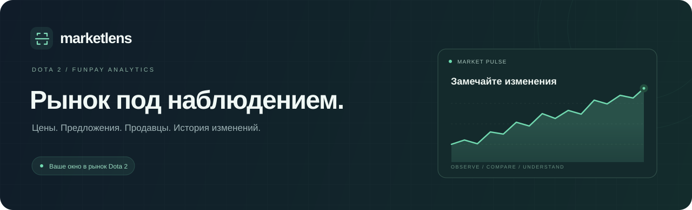
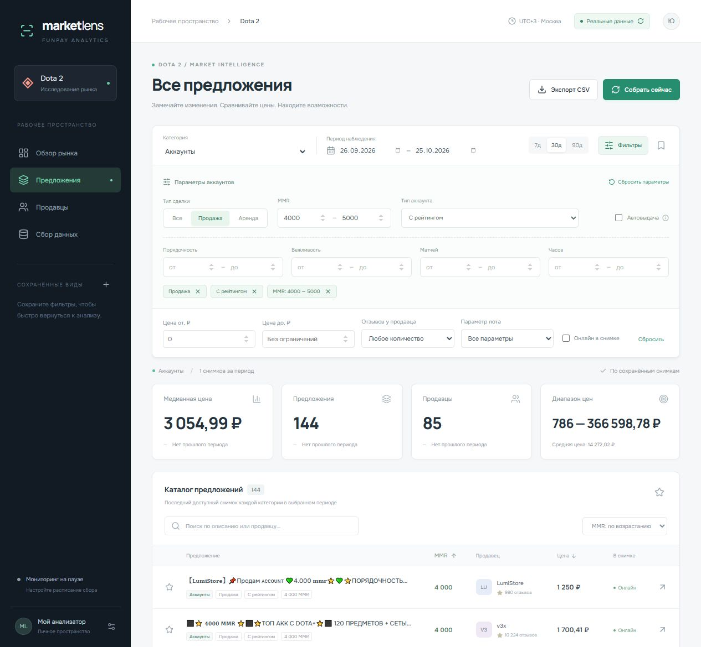
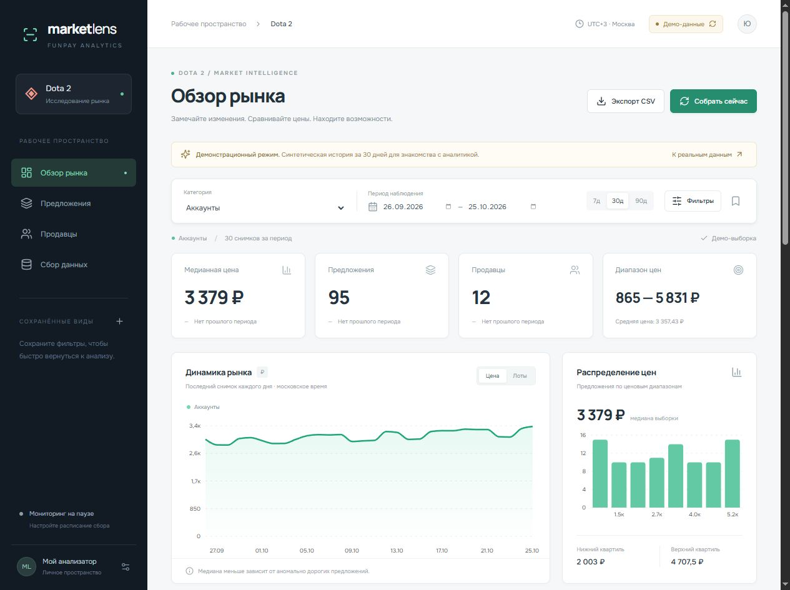

<div align="center">



# Market Lens

**Ваше рабочее пространство для анализа рынка Dota 2 на FunPay.**

Наблюдайте за ценами, сравнивайте предложения и накапливайте собственную историю рынка.

[](package.json)
[](#-быстрый-старт)
[](package.json)
[](#-данные-и-обслуживание)
[](LICENSE)

[Возможности](#-что-умеет-market-lens) · [Быстрый старт](#-быстрый-старт) · [Сервер](#-на-своём-сервере) · [Как считаются данные](#-как-читать-аналитику) · [Разработка](#-для-разработки)

</div>

---

## ✨ Что умеет Market Lens

|                         | Возможности                                                                                                                                                                                                                                                              |
| :---------------------- | :----------------------------------------------------------------------------------------------------------------------------------------------------------------------------------------------------------------------------------------------------------------------- |
| **📊 Обзор рынка**      | Медианная и средняя цена, минимум и максимум, квартильный диапазон, число предложений и уникальных продавцов. Сравнение с предыдущим периодом.                                                                                                                           |
| **📈 Графики**          | История медианной цены и количества лотов, распределение цен, отдельные линии категорий и история конкретного объявления.                                                                                                                                                |
| **🎯 Точная выборка**   | Категория, произвольный период, цена, число отзывов, онлайн-статус в снимке, поиск по описанию или продавцу продажа/аренда, тип аккаунта и диапазоны MMR, порядочности, вежливости, матчей и часов. Дополнительные параметры лота можно комбинировать с этими фильтрами. |
| **🗂 Предложения**      | Сортировка по цене, MMR, порядочности, вежливости, матчам и часам; пагинация, подробности лота, переход на FunPay, избранное на текущей странице и экспорт всей отфильтрованной выборки в CSV.                                                                           |
| **👥 Продавцы**         | Топ-12 по количеству объявлений в выборке, медианная цена предложений, отзывы и зафиксированный онлайн-статус.                                                                                                                                                           |
| **⏱ Постоянный сбор**  | Ручной запуск, расписание, включение категорий, журнал результатов и ошибок, настройка срока хранения.                                                                                                                                                                   |
| **🔖 Сохранённые виды** | Быстрый возврат к выбранным категориям, датам и фильтрам из бокового меню.                                                                                                                                                                                               |
| **🧪 Демо-режим**       | Синтетическая история за 30 дней, чтобы познакомиться с интерфейсом до накопления реальных данных.                                                                                                                                                                       |

### Фильтры аккаунтов как на FunPay

| Поле                          | Что можно выбрать                                                               |
| :---------------------------- | :------------------------------------------------------------------------------ |
| **Тип сделки**                | Все предложения, продажа или аренда                                             |
| **MMR**                       | Диапазон «от/до» и числовая сортировка по возрастанию или убыванию              |
| **Тип аккаунта**              | Для продажи: с рейтингом, под калибровку (TBD), без доступа к рейтинговым играм |
| **Порядочность и вежливость** | Независимые диапазоны значений                                                  |
| **Матчи и часы**              | Диапазон количества матчей; часы доступны для продаваемых аккаунтов с рейтингом |
| **Автовыдача**                | Только предложения с автоматической выдачей, по данным нового сборщика          |

Основные параметры доступны сразу под выбором периода; остальные открываются кнопкой «Фильтры». Активные параметры отображаются отдельными метками и сбрасываются по одному. Заголовок столбца **MMR** переключает направление сортировки.

MMR берётся из структурированного поля `solommr`, без догадок по описанию. Неизвестный MMR идёт в конце при обоих направлениях сортировки и исключается при заданном диапазоне. Для признака автовыдачи нужны снимки, собранные после обновления; старые снимки сохраняются без изменений.

<details>
<summary><strong>Посмотреть фильтры аккаунтов и колонку MMR</strong></summary>



</details>

### Один экран — весь контекст



<sub>На скриншоте включён демонстрационный режим. История и показатели синтетические; реальные снимки хранятся отдельно.</sub>

### Разделы Dota 2

`Аккаунты` · `Буст MMR` · `Калибровка` · `Предметы` · `Отмыв ЛП` · `Обучение` · `Dota+` · `VHS`

Нужен другой раздел? Добавьте публичную ссылку вида `https://funpay.com/lots/123/` в центре сбора данных.

## 🚀 Быстрый старт

Понадобятся **Node.js 22.13+** (рекомендуется **24 LTS**) и **pnpm 11.25.0**.

```sh
git clone --branch main https://github.com/ubica1/funpay-analyzer.git
cd funpay-analyzer

npm install -g pnpm@11.25.0
pnpm install --frozen-lockfile
pnpm build
pnpm start
```

Откройте **[127.0.0.1:3400](http://127.0.0.1:3400)**.

1. **Получите первый снимок.** Нажмите «Собрать сейчас»: приложение прочитает включённые категории.
2. **Выберите рынок.** Переключитесь на «Реальные данные», укажите категорию, период и параметры.
3. **Начните накапливать историю.** Откройте «Сбор данных», включите расписание и сохраните настройки.

По умолчанию включены аккаунты, буст MMR и калибровка. Автоматический сбор включается пользователем. До появления реальных снимков приложение открывает обозначенный демо-режим.

<details>
<summary><strong>Запуск на Windows</strong></summary>

После установки зависимостей и сборки запустите **[`start-local.cmd`](start-local.cmd)** двойным щелчком.

Файл проверяет версию Node.js и запускает сервер. При наличии установленного Codex runtime используется его Node.js, иначе — системный. Для остановки нажмите `Ctrl+C` в окне запуска.

</details>

## 🐳 На своём сервере

В репозитории подготовлены Dockerfile и Docker Compose: перезапуск контейнера, постоянный том SQLite и вход по паролю.

```sh
cp .env.example .env
```

Откройте `.env` и задайте **собственный длинный пароль** в `ANALYZER_PASSWORD`. Затем:

```sh
docker compose up -d --build
```

| Что настроено  | Поведение                                                                                               |
| :------------- | :------------------------------------------------------------------------------------------------------ |
| **Хранение**   | База остаётся в Docker-томе `market-data` при пересоздании контейнера.                                  |
| **Перезапуск** | Политика `unless-stopped` возвращает приложение после перезапуска Docker.                               |
| **Доступ**     | Порт `3400` привязан к `127.0.0.1` сервера. Логин по умолчанию — `admin`, пароль берётся из `.env`.     |
| **Расписание** | Хранится в базе и возобновляется после запуска приложения. Ближайший сбор — через настроенный интервал. |
| **Реплики**    | Одна: планировщик работает внутри процесса приложения.                                                  |

Для доступа со своего компьютера удобно использовать SSH-туннель:

```sh
ssh -L 3400:127.0.0.1:3400 user@server
```

После подключения откройте [127.0.0.1:3400](http://127.0.0.1:3400). Для доступа через домен используйте reverse proxy с HTTPS. HTTP Basic передавайте через HTTPS или SSH-туннель.

> **Проверка развёртывания:** приложение и production-сборка проверены локально. Docker-конфигурация подготовлена; запуск контейнера нужно проверить в целевом окружении.

### Настройки сбора

Настраиваются прямо в интерфейсе, без редактирования конфигурационных файлов.

| Параметр         | По умолчанию                   | Доступно                                  |
| :--------------- | :----------------------------- | :---------------------------------------- |
| Расписание       | Выключено                      | Включение и пауза                         |
| Интервал         | 1 час                          | 15 мин, 30 мин, 1, 2, 6, 12 или 24 часа   |
| Хранение истории | 30 дней                        | 7, 14, 30, 90, 180 или 365 дней           |
| Категории        | Аккаунты, буст MMR, калибровка | Включение разделов и добавление по ссылке |

Сервер должен работать постоянно, чтобы сборщик выполнял расписание. После прохода сборщика снимки старше выбранного срока удаляются.

<details>
<summary><strong>Переменные окружения</strong></summary>

| Переменная          | По умолчанию         | Назначение                                              |
| :------------------ | :------------------- | :------------------------------------------------------ |
| `PORT`              | `3400`               | Порт HTTP-сервера                                       |
| `HOST`              | `127.0.0.1`          | Адрес прослушивания; в контейнере — `0.0.0.0`           |
| `DATABASE_PATH`     | `data/market.sqlite` | Путь к SQLite; в контейнере — `/app/data/market.sqlite` |
| `ANALYZER_USER`     | `admin`              | Логин HTTP Basic                                        |
| `ANALYZER_PASSWORD` | Не задан             | Пароль; обязателен при `NODE_ENV=production`            |

При обычном `pnpm start` файл `.env` автоматически не читается. Для загрузки переменных из файла:

```sh
node --env-file=.env server/index.mjs
```

Docker Compose передаёт переменные самостоятельно; Windows-файл запуска также поддерживает `.env`.

</details>

## 🔍 Как читать аналитику

Market Lens сохраняет **снимки публичных объявлений**. Показатели описывают наблюдаемое предложение на рынке.

| Показатель              | Как считается                                                                                                                   |
| :---------------------- | :------------------------------------------------------------------------------------------------------------------------------ |
| **Сводка и таблица**    | Последний доступный снимок каждой выбранной категории внутри периода. Повторные наблюдения одного объявления не суммируются.    |
| **Медиана**             | Центральная цена отфильтрованных предложений. Меньше зависит от единичных аномально дорогих лотов, чем средняя.                 |
| **Квартили**            | P25 и P75 — границы центральной половины ценовой выборки.                                                                       |
| **Изменение за период** | Сравнение с последним доступным снимком в предыдущем периоде той же длины, с теми же фильтрами.                                 |
| **График**              | Последний снимок каждого дня отдельно по категориям; выбранные фильтры применяются и к нему.                                    |
| **Продавцы**            | Уникальные продавцы в последних снимках после фильтрации.                                                                       |
| **Покрытие**            | Число собранных уникальных объявлений относительно счётчика категории FunPay. При неизвестном счётчике покрытие не вычисляется. |
| **CSV**                 | Вся текущая отфильтрованная выборка из последних снимков, независимо от страницы таблицы.                                       |

**Время:** Москва, UTC+3. Дни без наблюдений остаются пустыми. Для сопоставления цен выбирайте однородные товары и единицы услуги: общая медиана нескольких категорий может смешивать разные продукты.

### Границы данных

- **История начинается с первого сбора.** Прошлые месяцы автоматически не восстанавливаются.
- **Выборка может быть неполной.** FunPay ограничивает число объявлений в ответе. Покрытие показывается по исходному снимку и не меняется при применении фильтров. Показатели не экстраполируются на весь рынок.
- **Публичный каталог не подтверждает сделки.** Продажи, выручка и конверсия не вычисляются. Исчезновение объявления может означать удаление, скрытие или изменение выдачи.
- **Отзывы относятся ко всему профилю продавца.** Онлайн-статус зафиксирован при сборе.
- **Избранное и сохранённые виды привязаны к браузеру.** Они хранятся в localStorage; фильтр избранного действует на текущей странице таблицы.
- **Демо изолировано.** Синтетические данные находятся в памяти и не записываются в рабочую SQLite-базу.

<details>
<summary><strong>Поведение сборщика при ошибках</strong></summary>

Один запрос на категорию, пауза 5 секунд между категориями, таймаут 45 секунд и лимит ответа 20 МБ. Сборщик читает публичные объявления в рублях без авторизации и обхода защиты.

При CAPTCHA, ошибке HTTP, другой валюте или пустом разборе новый снимок не создаётся. Последний успешный снимок остаётся доступным с датой сбора, а ошибка появляется в журнале. После HTTP 403/429 следующая попытка выполняется по расписанию.

Разметка FunPay может измениться. Парсер изолирован в `server/collector.mjs`, поэтому его можно обновить независимо от интерфейса и расчётов.

</details>

## 💾 Данные и обслуживание

SQLite работает в режиме WAL. Снимок и объявления сохраняются одной транзакцией; повторяющиеся ID лотов удаляются из выборки.

Размер базы зависит от количества категорий, числа предложений, частоты сбора и срока хранения. Например, 3 категории × 3 000 лотов × 24 снимка × 30 дней дают около **6,5 млн наблюдений**. Увеличивайте интервал или сокращайте срок хранения, если нужно уменьшить объём истории.

Для резервной копии остановите приложение, сохраните **весь каталог базы или Docker-том** (включая WAL-файлы, если они есть), затем запустите приложение снова. Удаление тома `market-data` удаляет историю.

После удаления старых снимков SQLite переиспользует освободившееся место. Для физического уменьшения файла базы остановите приложение и выполните `VACUUM`, обеспечив запас свободного места.

## 🛠 Для разработки

**Интерфейс:** React 19 · TypeScript · Recharts · Lucide · Vite<br />
**Сервер:** Node.js · Express · SQLite · Cheerio · Zod

| Команда       | Назначение                                               |
| :------------ | :------------------------------------------------------- |
| `pnpm dev`    | API с перезапуском при изменениях, порт `3400`           |
| `pnpm dev:ui` | Vite, порт `5173`, запросы `/api` проксируются на сервер |
| `pnpm test`   | Автоматические проверки серверной логики                 |
| `pnpm build`  | Проверка TypeScript и production-сборка интерфейса       |
| `pnpm start`  | Сервер приложения со собранным интерфейсом               |

Для разработки запустите API и Vite в двух терминалах.

```text
funpay-analyzer/
├── src/                  Интерфейс, графики, типы и стили
├── server/
│   ├── db.mjs            База, снимки, настройки и демо
│   ├── collector.mjs     Парсер и планировщик сбора
│   ├── analytics.mjs     Фильтры, статистика и CSV
│   └── index.mjs         HTTP API, авторизация и сервер
├── tests/                Автоматические проверки
├── docs/images/          Превью продукта
├── compose.yaml          Постоянный серверный запуск
└── start-local.cmd       Запуск на Windows
```

**Проверено для этой версии:** production-сборка, 22 автоматических теста и пробный сбор публичных страниц FunPay. Тесты покрывают статистику, фильтры, границы дат, атомарность снимков, повторы лотов, парсер, CSV, HTTP API и доступ по паролю.

---

<div align="center">

**Market Lens · Observe. Compare. Understand.**

Независимый проект для анализа публичного рынка FunPay.<br />
Не связан с FunPay или Valve. Dota 2 и другие торговые марки принадлежат их владельцам.

[MIT License](LICENSE) · [Репозиторий](https://github.com/ubica1/funpay-analyzer) · [Источник объявлений](https://funpay.com/lots/81/)

</div>
